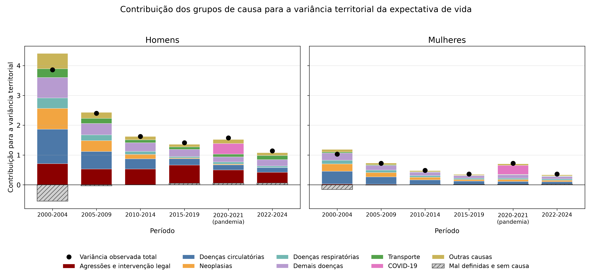
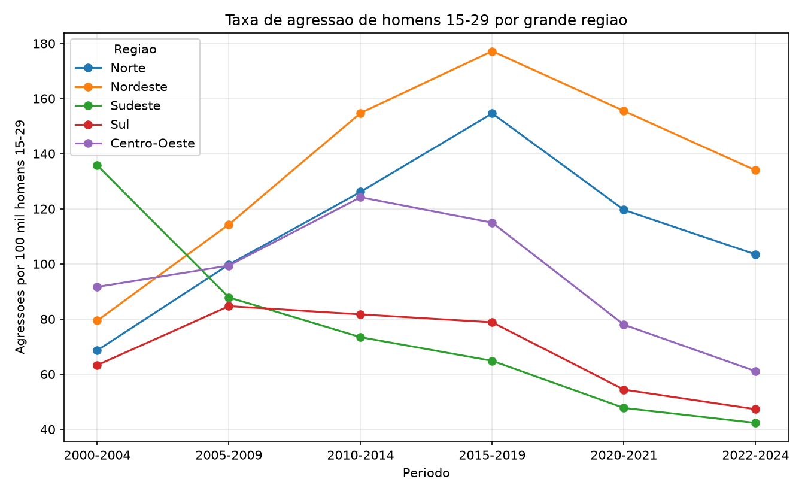

# Da geografia da violência à geografia da desigualdade: homicídios e expectativa de vida nos territórios brasileiros, 2000–2024

## Manuscrito de trabalho — versão 0.3, 27/11/2026

**Autores:** a definir  
**Afiliação:** a definir  
**Tipo de artigo:** pesquisa original, estudo ecológico de pequenas áreas  
**Base analítica:** 558 microrregiões brasileiras, 2000–2024

---

## Resumo

**Objetivo:** Analisar como mudou, entre 2000 e 2024, a composição das causas associadas à desigualdade territorial da expectativa temporária de vida entre 0 e 80 anos nas 558 microrregiões brasileiras, com atenção ao papel dos homicídios nessa transformação.

**Métodos:** Estudo ecológico de séries temporais agregadas, com óbitos do Sistema de Informações sobre Mortalidade (SIM/DATASUS) e exposições populacionais POPSVS. A variância territorial, com pesos iguais entre microrregiões, da expectativa temporária de vida entre 0 e 80 anos foi decomposta por grupos de causas mediante cenários contrafactuais de equalização das taxas locais para taxas nacionais e atribuição de Shapley. Foram mantidos os métodos da versão 0.2, incluindo a sensibilidade à redistribuição de óbitos por intenção indeterminada. Análises complementares descreveram a composição percentual da decomposição, a distribuição regional dos homicídios e a heterogeneidade territorial específica das agressões.

**Resultados:** Entre os homens, a variância territorial da expectativa temporária de vida caiu de 3,86 em 2000–2004 para 1,41 em 2015–2019 e 1,14 em 2022–2024. Na queda entre 2000–2004 e 2015–2019, as contribuições percentuais foram 38,5% para doenças circulatórias, 27,4% para neoplasias, 18,1% para demais doenças e 12,5% para doenças respiratórias; agressões contribuíram com 2,0%. Em valores absolutos, a contribuição das agressões caiu apenas modestamente, de 0,71 para 0,66, enquanto circulatórias diminuíram de 1,16 para 0,22 e neoplasias de 0,70 para 0,03. Por isso, agressões passaram a representar 46,7% da desigualdade remanescente em 2015–2019, ante 18,4% em 2000–2004. Entre mulheres, a contribuição percentual das agressões permaneceu abaixo de 3%. A distribuição regional dos homicídios masculinos deslocou-se em direção ao Nordeste: sua participação passou de 22,8% para 49,0%, enquanto a do Sudeste caiu de 56,1% para 21,9%. Entre homens de 15–29 anos, τ permaneceu entre 0,75 e 0,85, padrão compatível com persistência da heterogeneidade territorial.

**Conclusão:** A redução da desigualdade territorial masculina de sobrevivência esteve associada sobretudo à convergência das doenças. Os homicídios não acompanharam essa redução na mesma magnitude e passaram a representar parcela maior da desigualdade remanescente. A interpretação deve considerar a melhora da classificação das causas de morte, especialmente no Norte e Nordeste.

**Palavras-chave:** expectativa temporária de vida; desigualdade territorial; homicídios; causas de morte; microrregiões; Brasil.

---

## 1. Introdução

A sobrevivência humana é marcada por diferenças territoriais que refletem, entre outros fatores, condições socioeconômicas, estrutura etária, exposição a riscos, acesso a serviços e qualidade dos sistemas de informação. No Brasil, a distribuição espacial da mortalidade por homicídios e suas mudanças ao longo do tempo foram documentadas em diferentes escalas. A literatura também demonstrou que causas de morte distintas contribuem de maneira desigual para diferenças regionais de sobrevivência e para a dispersão da idade à morte.

Há precedentes importantes para a análise da composição causal das diferenças de sobrevivência. Calazans, Guimarães e Nepomuceno (2023) examinaram contribuições de grupos etários e causas para a variação regional da esperança de vida e da dispersão da idade à morte no Brasil. Monteiro da Silva et al. (2026) analisaram contribuições de idade e causas para o hiato urbano-rural de mortalidade no país. Vierboom, Preston e Hendi (2019) decompuseram mudanças na variância geográfica da expectativa de vida por idade e causa, mediante substituição de taxas locais por taxas nacionais. Lima et al. (2024), por sua vez, estudaram a qualidade dos dados de mortalidade e a mortalidade adulta em pequenas áreas, utilizando as 558 microrregiões brasileiras entre 1980 e 2010. Esses trabalhos estabelecem que a decomposição por causas, a análise em pequenas áreas e a avaliação da qualidade do registro possuem antecedentes metodológicos e substantivos.

A literatura brasileira também já documentou a redistribuição territorial dos homicídios entre microrregiões no período de 2000 a 2015, em estudo publicado em *Ciência & Saúde Coletiva* (2020, v. 25, n. 8, p. 3097–3105) [VERIFICAR: autoria e DOI]. Portanto, o deslocamento relativo da violência entre macrorregiões não é apresentado aqui como contribuição original. Neste estudo, esse processo é tratado como contexto já documentado e atualizado com dados até 2024.

A questão central é outra: como mudou a composição das causas que produzem a desigualdade territorial da expectativa temporária de vida entre as microrregiões brasileiras, e qual foi o papel dos homicídios nessa mudança? A distinção entre a magnitude absoluta da contribuição de uma causa e sua participação percentual na desigualdade remanescente é essencial. Uma causa pode representar parcela crescente do total não porque sua contribuição absoluta tenha aumentado, mas porque outros componentes diminuíram mais rapidamente.

A hipótese interpretativa examinada é que a desigualdade territorial masculina de sobrevivência diminuiu substancialmente, mas sua composição mudou. A queda foi associada principalmente à convergência territorial das doenças — circulatórias, neoplasias, respiratórias e demais doenças — enquanto a contribuição absoluta dos homicídios se reduziu apenas modestamente. Como consequência, os homicídios passaram a constituir o maior componente isolado da desigualdade remanescente em 2015–2019. A formulação é estatística e descritiva: não atribui causalidade às causas de morte nem às características dos territórios.

O objetivo deste artigo é analisar a mudança da composição causal da desigualdade territorial da expectativa temporária de vida entre 0 e 80 anos nas 558 microrregiões brasileiras, entre 2000 e 2024, distinguindo a queda da desigualdade total da redistribuição relativa de seus componentes. Como análises complementares, descreve-se a distribuição regional dos homicídios, a heterogeneidade territorial específica das agressões e o padrão observado segundo quintis de IDHM.

---

## 2. Métodos

### 2.1 Desenho e unidade de análise

Estudo ecológico de séries temporais agregadas, com unidade territorial principal definida pelas microrregiões do IBGE disponíveis na base analítica. Embora o CADMUN registre 586 códigos de microrregião, os arquivos de taxas e os modelos versionados utilizam 558 unidades. A razão dessa diferença deve ser reconciliada por código antes da submissão; até lá, o universo analítico é descrito como 558 microrregiões disponíveis na base.

As análises foram realizadas separadamente para homens e mulheres. Os períodos foram:
- 2000–2004;
- 2005–2009;
- 2010–2014;
- 2015–2019;
- 2020–2021 (pandemia);
- 2022–2024.

### 2.2 Fontes de dados

Os óbitos por residência foram obtidos do SIM/DATASUS, para 2000–2024. As exposições populacionais por município, sexo e idade foram obtidas das estimativas POPSVS do DATASUS. A associação entre município e microrregião foi feita com a tabela CADMUN.

Os dados foram agregados por sexo e por 18 grupos etários: 0, 1–4, 5–9, ..., 75–79 e 80 anos ou mais. Óbitos com sexo ou idade ignorados não foram imputados. Registros sem município identificável foram contabilizados separadamente nos totais de UF e Brasil, mas não atribuídos artificialmente a uma microrregião.

### 2.3 Tábuas de vida e medidas complementares

Foram construídas tábuas de vida abreviadas a partir das taxas centrais de mortalidade, calculadas como óbitos divididos por pessoas-ano. A medida de sobrevivência analisada foi a **expectativa temporária de vida entre 0 e 80 anos (e0-80)**, utilizada para comparar territórios, pois não depende da faixa aberta de 80 anos ou mais. A probabilidade de morrer entre 15 e 60 anos (q15-60) foi utilizada como medida complementar.

A faixa de idade zero utiliza população estimada como denominador. Não equivale à taxa de mortalidade infantil calculada com nascidos vivos; essa distinção é particularmente importante na interpretação de H1.

### 2.4 Modelo de heterogeneidade territorial

Para cada combinação de sexo, período e faixa etária, os óbitos observados na microrregião (i) foram modelados como:

\[
D_i \sim \operatorname{Poisson}\{E_i\exp(\mu+u_i)\},
\qquad u_i\sim N(0,\tau^2).
\]

O valor \(E_i\) corresponde aos óbitos esperados se a microrregião apresentasse a taxa de mortalidade do restante do Brasil na mesma idade, sexo e período. A própria microrregião é excluída do cálculo da taxa de referência (leave-one-out). O parâmetro \(\mu\) representa o nível médio comum e \(\tau\) é o desvio-padrão dos efeitos territoriais na escala logarítmica.

Assim, \(\tau\) quantifica a heterogeneidade residual entre microrregiões após considerar a variação Poisson. Sob a distribuição normal dos efeitos, a razão esperada entre os percentis 90 e 10 dos riscos territoriais é \(\exp(2{,}563\tau)\). O parâmetro não representa uma medida pura de desigualdade da mortalidade real: inclui também diferenças persistentes na cobertura do SIM e erros dos denominadores populacionais.

A verossimilhança marginal foi aproximada por quadratura de Gauss-Hermite adaptativa, com 15 nós e otimização numérica. O modelo foi avaliado previamente por simulações com valores conhecidos de \(\tau\). Os intervalos de perfil de verossimilhança foram utilizados para estimativas pontuais de \(\tau\).

### 2.5 Dependência espacial e inferência

A validação espacial identificou autocorrelação dos efeitos territoriais e concentração de variação entre unidades da Federação. Por isso, as comparações entre faixas etárias e sexos foram avaliadas por bootstrap em blocos de UF, preservando os mesmos sorteios entre os grupos comparados. Foram utilizadas 300 replicações nos períodos, com semente fixa 20261124. A inferência por blocos produz intervalos mais amplos do que a reamostragem de microrregiões independentes.

O bootstrap por UF possui apenas 27 blocos e deve ser entendido como aproximação. As simulações de cobertura indicam que a inferência para uma população hipotética de áreas pode permanecer otimista sob dependência espacial forte ou desvios da normalidade. A interpretação principal é, portanto, referente às 558 microrregiões observadas, com generalização condicionada às hipóteses do modelo e do bootstrap.

### 2.6 Decomposição H10 da variância territorial por causas

A decomposição utiliza a variância territorial, com pesos iguais entre microrregiões, da **expectativa temporária de vida entre 0 e 80 anos (e0-80)**. Para cada combinação de sexo e período, são construídos cenários contrafactuais nos quais as taxas locais de um ou mais grupos de causas são substituídas pela taxa nacional correspondente à mesma idade, sexo e período. A variância da expectativa temporária de vida é recalculada em cada cenário.

As contribuições são atribuídas pelo valor de Shapley, calculado sobre todos os subconjuntos de grupos. A atribuição distribui simetricamente as interações e não depende de uma única ordem de substituição. A soma das contribuições corresponde à redução entre a variância observada e a variância com todos os grupos equalizados, salvo erro numérico. Contribuições positivas indicam redução da variância após equalização; contribuições negativas indicam aumento no cenário contrafactual. A variância observada é apresentada separadamente e não é contribuição percentual.

Os grupos são: agressões e intervenção legal; intenção indeterminada; suicídio; transporte; demais causas externas; COVID-19; infecciosas sem COVID-19; neoplasias; circulatórias; respiratórias; mal definidas e sem causa; e demais doenças. A decomposição utiliza os arquivos V2 e fração zero de redistribuição de intenção indeterminada, salvo na análise de sensibilidade.

### 2.7 Sensibilidade à intenção indeterminada

A sensibilidade foi avaliada para a contribuição de agressões e intervenção legal entre homens, redistribuindo fração 0,0, 0,5 ou 1,0 dos óbitos classificados como intenção indeterminada para esse grupo. São cenários explícitos, não uma afirmação de que todos os óbitos indeterminados sejam agressões. Os resultados são apresentados com base em ARTIGO_TABELA2_SENSIBILIDADE_V2.csv.

### 2.8 Heterogeneidade territorial específica das agressões

A heterogeneidade territorial das agressões foi estimada pelo parâmetro \(\tau\) para homens e mulheres, por período e faixa etária, com IC95%. A comparação temporal considera a sobreposição dos intervalos.

### 2.9 Registros B34.2 com e sem U07

A análise descritiva contabiliza, por ano, registros B34.2 com U07 e sem U07, conforme ARTIGO_TABELA4_COVID_V2.csv. As contagens não recebem interpretação causal ou validação clínica individual.

### 2.10 Ética e proteção de dados

O estudo utiliza dados secundários públicos agregados. Nenhum registro individual é armazenado nos resultados analíticos versionados. As conclusões são ecológicas e não devem ser interpretadas como associações individuais.

---

## 3. Resultados

### 3.1 Queda da desigualdade territorial da expectativa temporária de vida

A variância territorial da expectativa temporária de vida entre 0 e 80 anos entre os homens diminuiu ao longo do período analisado. A variância observada foi 3,86 em 2000–2004, 1,41 em 2015–2019 e 1,14 em 2022–2024. A trajetória intermediária também apresentou redução, embora não estritamente monotônica: 2,40 em 2005–2009, 1,62 em 2010–2014 e 1,58 em 2020–2021.

Entre as mulheres, a variância observada foi menor em todos os períodos: 1,03 em 2000–2004, 0,36 em 2015–2019 e 0,36 em 2022–2024. Os valores completos por sexo e período estão apresentados na Tabela 1 (H10_RESULTADOS_V2.csv).

**Tabela 1. Variância territorial observada da expectativa temporária de vida entre 0 e 80 anos, por sexo e período (H10_RESULTADOS_V2.csv).**

| Sexo | 2000–2004 | 2005–2009 | 2010–2014 | 2015–2019 | 2020–2021 | 2022–2024 |
|---|---:|---:|---:|---:|---:|---:|
| Homens | 3,86 | 2,40 | 1,62 | 1,41 | 1,58 | 1,14 |
| Mulheres | 1,03 | 0,72 | 0,49 | 0,36 | 0,72 | 0,36 |

A redução da variância total, isoladamente, não informa quais causas estiveram associadas à mudança. Para isso, é necessário observar simultaneamente as contribuições absolutas dos grupos e sua participação percentual na queda.

### 3.2 Decomposição da queda: convergência das doenças e persistência relativa dos homicídios

Entre 2000–2004 e 2015–2019, a contribuição absoluta das agressões e intervenção legal à variância territorial caiu apenas modestamente, de 0,71 para 0,66. Em contraste, as contribuições das doenças diminuíram de forma acentuada: circulatórias passaram de 1,16 para 0,22; neoplasias, de 0,70 para 0,03; demais doenças, de 0,68 para 0,24; e respiratórias, de 0,35 para 0,05. Os valores para os três períodos de referência estão reunidos na Tabela 2 (V03_TABELA_QUEDA.csv).

**Tabela 2. Contribuições absolutas dos grupos de causas para a decomposição da variância territorial masculina e participação na queda de 2000–2004 a 2015–2019 (V03_TABELA_QUEDA.csv).**

| Grupo de causa | 2000–2004 | 2015–2019 | 2022–2024 | Participação na queda 2000–04 a 2015–19 |
|---|---:|---:|---:|---:|
| Circulatórias | 1,16 | 0,22 | 0,16 | 38,5% |
| Neoplasias | 0,70 | 0,03 | 0,00 | 27,4% |
| Demais doenças | 0,68 | 0,24 | 0,22 | 18,1% |
| Respiratórias | 0,35 | 0,05 | 0,05 | 12,5% |
| Agressões e intervenção legal | 0,71 | 0,66 | 0,42 | 2,0% |
| Infecciosas sem COVID-19 | 0,22 | 0,07 | 0,05 | 6,1% |
| Transporte | 0,29 | 0,08 | 0,14 | 8,6% |
| Demais causas externas | 0,15 | 0,01 | 0,04 | 5,9% |
| Suicídio | 0,06 | -0,02 | -0,01 | 3,6% |
| Intenção indeterminada | 0,08 | 0,04 | 0,02 | 1,7% |
| Mal definidas e sem causa | -0,55 | 0,05 | 0,06 | -24,6% |
| COVID-19 | 0,00 | 0,00 | 0,00 | 0,0% |

A queda total da variância observada masculina entre 2000–2004 e 2015–2019 foi de aproximadamente 2,45 (3,86 para 1,41). As porcentagens da tabela expressam a participação de cada grupo na decomposição da queda e não devem ser interpretadas como frações de óbitos. A contribuição negativa das causas mal definidas indica que, no cenário contrafactual correspondente, sua equalização aumentou a variância; sua interpretação exige considerar a mudança da qualidade de certificação, discutida adiante.

A contribuição absoluta das agressões caiu de 0,7085 para 0,6590 e, depois, para 0,4170 em 2022–2024. Assim, não houve aumento absoluto entre o primeiro e o segundo período de referência. O que ocorreu foi uma redução muito mais intensa de vários componentes relacionados às doenças. A Figura 1 sintetiza essa mudança: a desigualdade territorial diminuiu e sua composição relativa se reorganizou (V03_FIGURA_SINTESE.png).

**Figura 1.** Síntese da queda da variância territorial e da mudança da composição causal entre os períodos de referência (V03_FIGURA_SINTESE.png).

### 3.3 Composição da desigualdade remanescente e sensibilidade

A participação percentual das agressões e intervenção legal na decomposição masculina passou de 18,4% em 2000–2004 para 46,7% em 2015–2019. Nesse último período, agressões constituíram o maior componente isolado da desigualdade remanescente. Essa mudança percentual deve ser lida em conjunto com os valores absolutos apresentados na seção anterior: a contribuição das agressões se reduziu pouco no primeiro intervalo, enquanto a contribuição das doenças caiu acentuadamente.

A decomposição completa por sexo e período está apresentada na Tabela 3 (ARTIGO_TABELA1_H10_V2.csv). Entre as mulheres, a participação das agressões permaneceu sempre abaixo de 3%: variou de 2,72% em 2000–2004 a 2,43% em 2015–2019 e 1,92% em 2022–2024. Em 2022–2024, a contribuição da COVID-19 foi 0,3% entre homens e 1,9% entre mulheres, indicando que a pandemia não explica a passagem das agressões à condição de maior componente isolado em 2015–2019, período anterior à COVID-19.

**Tabela 3. Participação percentual das agressões, doenças circulatórias, neoplasias e COVID-19 na decomposição H10, por sexo e período (ARTIGO_TABELA1_H10_V2.csv).**

| Sexo e grupo | 2000–2004 | 2015–2019 | 2020–2021 | 2022–2024 |
|---|---:|---:|---:|---:|
| Homens — agressões | 18,4% | 46,7% | 31,7% | 36,6% |
| Homens — circulatórias | 30,0% | 15,3% | 10,8% | 14,2% |
| Homens — neoplasias | 18,0% | 1,8% | 1,7% | 0,3% |
| Homens — COVID-19 | 0,0% | 0,0% | 22,7% | 0,3% |
| Mulheres — agressões | 2,7% | 2,4% | 1,3% | 1,9% |
| Mulheres — circulatórias | 41,4% | 31,8% | 14,1% | 26,0% |
| Mulheres — neoplasias | 24,0% | 15,0% | 8,9% | 14,1% |
| Mulheres — COVID-19 | 0,0% | 0,0% | 42,0% | 1,9% |

A análise de sensibilidade à intenção indeterminada manteve a contribuição percentual das agressões masculina em valores próximos aos do cenário principal. Em 2015–2019, a contribuição foi 46,67% quando nenhuma fração dos registros indeterminados foi redistribuída, 47,94% com redistribuição de metade e 49,21% com redistribuição integral. A variação entre cenários não altera a leitura de que as agressões já constituíam o maior componente isolado naquele período. Os resultados completos por período estão na Tabela 4 (ARTIGO_TABELA2_SENSIBILIDADE_V2.csv).

**Tabela 4. Sensibilidade da contribuição de agressões e intervenção legal entre homens à fração de óbitos por intenção indeterminada redistribuída (ARTIGO_TABELA2_SENSIBILIDADE_V2.csv).**

| Período | Fração 0,0 | Fração 0,5 | Fração 1,0 |
|---|---:|---:|---:|
| 2000–2004 | 18,37% | 19,37% | 20,38% |
| 2005–2009 | 22,13% | 22,45% | 22,78% |
| 2010–2014 | 32,50% | 32,59% | 32,69% |
| 2015–2019 | 46,67% | 47,94% | 49,21% |
| 2020–2021 | 31,74% | 32,83% | 33,92% |
| 2022–2024 | 36,57% | 37,45% | 38,33% |

### 3.4 Distribuição regional e persistência da heterogeneidade dos homicídios

A redistribuição regional dos homicídios masculinos constitui contexto importante para interpretar a mudança da composição territorial, mas não é apresentada como contribuição original deste estudo. Entre 2000–2004 e 2022–2024, a participação do Nordeste no total de homicídios de homens passou de 22,8% para 49,0%, enquanto a participação do Sudeste caiu de 56,1% para 21,9%. As participações regionais e as taxas por 100 mil pessoas-ano estão apresentadas na Tabela 5 (ONDE_TABELA5_REGIOES_V2.csv).

**Tabela 5. Participação regional nos homicídios masculinos e taxa de agressões por 100 mil pessoas-ano (ONDE_TABELA5_REGIOES_V2.csv).**

| Região | Participação 2000–2004 | Participação 2022–2024 | Taxa 2000–2004 | Taxa 2022–2024 |
|---|---:|---:|---:|---:|
| Norte | 5,7% | 13,8% | 68,6 | 103,5 |
| Nordeste | 22,8% | 49,0% | 79,4 | 133,9 |
| Sudeste | 56,1% | 21,9% | 135,7 | 42,3 |
| Sul | 8,7% | 8,6% | 63,3 | 47,3 |
| Centro-Oeste | 6,7% | 6,6% | 91,7 | 61,1 |

A Figura 2 apresenta a distribuição regional das taxas de agressões no período (ONDE_FIGURA4_REGIOES_V2.png). A tabela por unidades da Federação mostra que as taxas e posições relativas também variam dentro das macrorregiões; os códigos de UF e rankings completos são preservados na Tabela 6 (ONDE_TABELA6_UF_V2.csv).

**Figura 2.** Distribuição regional das taxas de agressões ao longo dos períodos (ONDE_FIGURA4_REGIOES_V2.png).

**Tabela 6.** Ranking das taxas estaduais de agressões por período, com códigos de UF, taxas por 100 mil pessoas-ano e contagens (ONDE_TABELA6_UF_V2.csv). A tabela-fonte contém as 27 unidades da Federação em cada período.

A análise de heterogeneidade territorial específica das agressões complementa a descrição regional. Entre homens de 15–29 anos, o parâmetro τ permaneceu entre 0,75 e 0,85 nos seis períodos, com intervalos de confiança sobrepostos. Esse padrão é descrito como persistência da heterogeneidade territorial, e não como evidência de queda ou aumento temporal. Entre mulheres de 15–29 anos, τ foi inferior em todos os períodos, variando aproximadamente de 0,50 a 0,62. Os valores por sexo, faixa etária e período estão na Tabela 7 (ARTIGO_TABELA3_TAU_HOMICIDIO_V2.csv).

**Tabela 7. τ de agressões para a faixa de 15–29 anos, por sexo e período (ARTIGO_TABELA3_TAU_HOMICIDIO_V2.csv).**

| Período | Homens τ (IC95%) | Mulheres τ (IC95%) |
|---|---|---|
| 2000–2004 | 0,85 (0,74–0,93) | 0,62 (0,52–0,72) |
| 2005–2009 | 0,75 (0,66–0,84) | 0,53 (0,45–0,61) |
| 2010–2014 | 0,78 (0,69–0,86) | 0,50 (0,42–0,57) |
| 2015–2019 | 0,80 (0,64–0,90) | 0,50 (0,41–0,55) |
| 2020–2021 | 0,83 (0,62–0,97) | 0,57 (0,42–0,66) |
| 2022–2024 | 0,79 (0,57–0,92) | 0,57 (0,42–0,66) |

### 3.5 Evidência complementar: taxas por quintil de IDHM

Como evidência complementar, a distribuição das taxas de agressões segundo quintis de IDHM mostra uma inversão do gradiente entre os extremos da distribuição. No quintil mais rico, a taxa caiu de 174,1 por 100 mil em 2000–2004 para 40,5 em 2022–2024. No quintil mais pobre, passou de 38,9 para 101,4 por 100 mil. Esse padrão observável é consistente com a mudança territorial descrita anteriormente, mas não constitui a descoberta principal e não deve ser interpretado como efeito causal do IDHM. Os dados completos estão na Tabela 8 (ONDE_TABELA7_IDHM_HOMICIDIO_V2.csv).

**Tabela 8. Taxa de agressões por 100 mil pessoas-ano nos quintis extremos de IDHM (ONDE_TABELA7_IDHM_HOMICIDIO_V2.csv).**

| Quintil de IDHM | 2000–2004 | 2022–2024 |
|---|---:|---:|
| Mais pobre (quintil 1) | 38,9 | 101,4 |
| Mais rico (quintil 5) | 174,1 | 40,5 |

---

## 4. Discussão

### 4.1 A mudança central: menor desigualdade, composição diferente

O resultado principal deste estudo é que, entre os homens, a desigualdade territorial de sobrevivência diminuiu substancialmente, mas sua composição mudou. A queda da variância territorial da expectativa temporária de vida foi associada sobretudo à redução das contribuições das doenças, especialmente circulatórias e neoplasias. A contribuição absoluta das agressões diminuiu apenas modestamente entre 2000–2004 e 2015–2019. Em consequência, as agressões passaram a representar parcela maior da desigualdade remanescente e se tornaram o maior componente isolado em 2015–2019.

A interpretação pode ser sintetizada da seguinte forma: **a desigualdade territorial caiu porque as doenças convergiram, não porque a violência convergiu.** Essa frase descreve a decomposição estatística observada e não afirma que a convergência das doenças tenha sido causada por uma política específica, nem que a violência tenha permanecido idêntica em todos os territórios. O padrão indica que componentes de desigualdade associados às doenças diminuíram mais rapidamente do que o componente associado às agressões.

É importante distinguir a participação relativa da contribuição absoluta. O aumento da participação percentual das agressões, de 18,4% para 46,7%, não significa que a contribuição absoluta dos homicídios tenha aumentado nesse intervalo. O valor absoluto caiu de aproximadamente 0,71 para 0,66. A mudança de composição ocorreu porque a contribuição das doenças caiu muito mais intensamente. Em 2022–2024, a contribuição absoluta das agressões foi 0,42, mas elas ainda representavam 36,6% da decomposição percentual.

### 4.2 Relação com a literatura e contexto territorial

Os resultados dialogam com estudos que analisaram diferenças regionais de mortalidade e contribuições de causas para diferenças de sobrevivência. Calazans, Guimarães e Nepomuceno (2023) demonstraram a relevância dos grupos de causas para a variação regional da esperança de vida e da dispersão da idade à morte. Monteiro da Silva et al. (2026) documentaram contribuições de causas externas para o hiato urbano-rural, especialmente entre homens jovens. Vierboom, Preston e Hendi (2019) constituem precedente direto para a decomposição da variância geográfica da expectativa de vida por idade e causa. A presente análise não reivindica a novidade da decomposição por causas em si; sua contribuição é descrever a mudança temporal da composição causal da variância da expectativa temporária de vida entre as microrregiões brasileiras e distinguir a trajetória absoluta da participação percentual dos homicídios.

A redistribuição regional observada até 2024 é compatível com a literatura brasileira que documentou o deslocamento dos homicídios em direção ao Norte e Nordeste entre 2000 e 2015 [VERIFICAR: referência completa do estudo de *Ciência & Saúde Coletiva*, 2020, v. 25, n. 8, p. 3097–3105]. Os resultados atuais atualizam esse contexto, mas não o apresentam como descoberta original. A persistência de τ elevado entre homens jovens mostra, adicionalmente, que a heterogeneidade territorial específica das agressões permaneceu expressiva ao longo dos seis períodos, mesmo quando a desigualdade total da expectativa temporária de vida diminuiu.

Uma hipótese interpretativa compatível com a literatura é que mudanças na dinâmica territorial dos mercados ilícitos e de grupos armados possam contribuir para padrões regionais de violência, mas os dados ecológicos deste estudo não permitem identificar mecanismos relacionados a facções nem testar essa hipótese.

### 4.3 Qualidade da certificação das causas de morte

A interpretação da decomposição de longo prazo precisa considerar a melhora da classificação das causas de morte. Entre 2000–2004 e 2022–2024, a proporção de óbitos classificados como mal definidos caiu de 26,5% para 5,2% no Nordeste e de 22,0% para 6,4% no Norte. A redução foi particularmente relevante justamente nas regiões em que a participação relativa dos homicídios aumentou. Os valores por região e período estão apresentados na Tabela 9 (V03_TABELA_MAL_DEFINIDAS.csv).

**Tabela 9. Proporção de óbitos por causas mal definidas, por região e período (V03_TABELA_MAL_DEFINIDAS.csv).**

| Região | 2000–2004 | 2015–2019 | 2022–2024 |
|---|---:|---:|---:|
| Norte | 22,0% | 7,6% | 6,4% |
| Nordeste | 26,5% | 6,6% | 5,2% |
| Sudeste | 9,1% | 5,7% | 5,4% |
| Sul | 6,3% | 3,6% | 3,2% |
| Centro-Oeste | 6,8% | 2,8% | 2,6% |

Na decomposição da queda da variância masculina entre 2000–2004 e 2015–2019, o grupo de causas mal definidas e sem causa apresentou contribuição negativa de –24,6%. Esse resultado reforça que a mudança na qualidade da certificação interfere na decomposição contrafactual: a equalização desse grupo, no cenário utilizado, aumentou a variância em vez de reduzi-la.

Portanto, parte da mudança observada na composição causal de longo prazo reflete a melhora da classificação das causas de morte, especialmente no Norte e Nordeste. Essa mudança não invalida o resultado principal, mas precisa ser considerada na interpretação das tendências. O grupo de causas mal definidas não é uma categoria substantiva comparável às causas específicas; sua distribuição e evolução afetam a atribuição estatística das contribuições. O estudo de Lima et al. (2024), realizado nas mesmas 558 microrregiões e com foco na qualidade dos registros de mortalidade, é referência central para essa cautela.

### 4.4 Robustez e pandemia

A interpretação central não depende da pandemia. As agressões já constituíam o maior componente isolado da desigualdade remanescente em 2015–2019, antes do período pandêmico. Em 2022–2024, a contribuição percentual da COVID-19 foi 0,3% entre homens e 1,9% entre mulheres. O pico de contribuição da COVID-19 em 2020–2021 é visível na decomposição, mas não explica a mudança de composição que já estava presente no período pré-pandêmico.

A sensibilidade à redistribuição de óbitos por intenção indeterminada também não altera a interpretação geral. Para homens em 2015–2019, a contribuição das agressões variou de 46,67% a 49,21% entre os cenários extremos. Essa análise não determina a causa verdadeira dos óbitos indeterminados, mas indica que a conclusão descritiva não depende exclusivamente da classificação no cenário de fração zero.

### 4.5 Limitações

Primeiro, a variância territorial da expectativa temporária de vida entre 0 e 80 anos é calculada entre as microrregiões disponíveis na base e não representa desigualdades entre indivíduos, bairros ou municípios isolados.

Segundo, a decomposição H10 depende da classificação dos grupos de causas e dos cenários contrafactuais de equalização. Contribuições negativas não significam proteção causal; indicam que a equalização do grupo aumentou a variância no cenário definido.

Terceiro, a análise de sensibilidade redistribui frações predeterminadas dos óbitos por intenção indeterminada. Os cenários não identificam a causa verdadeira dos registros e não substituem investigação individual ou validação externa.

Quarto, a inferência espacial por bootstrap utiliza unidades da Federação como blocos. O número limitado de blocos restringe a precisão e a generalização.

Quinto, as estimativas de τ para mulheres de 60 anos ou mais em 2010–2014, 2020–2021 e 2022–2024 são instáveis, poucos óbitos, e não devem ser interpretadas.

Sexto, a unidade territorial disponível é a microrregião. Os resultados não podem ser interpretados como desigualdades entre bairros, CEPs ou indivíduos. A análise por quintis de IDHM é ecológica e descritiva, não identifica efeito causal da condição socioeconômica.

Sétimo, a qualidade da certificação das causas de morte mudou ao longo da série, com redução expressiva das causas mal definidas no Norte e Nordeste. Essa mudança pode afetar a classificação dos componentes causais, e os resultados não incorporam uma propagação completa da incerteza de cobertura e qualidade do SIM. A tabela de sub-registro entre idosos (ONDE_TABELA8) não é apresentada nos resultados; permanece como limitação adicional, pois a incompletude dos registros pode afetar a comparabilidade temporal e territorial.

O estudo é ecológico e não permite atribuir causalidade a políticas, condições sociais, organizações criminosas ou características individuais. A decomposição estatística descreve como as contribuições contrafactuais se distribuem, sob os grupos de causas e cenários especificados.

---

## 5. Conclusão

Entre os homens, a desigualdade territorial de sobrevivência diminuiu substancialmente, mas sua composição mudou. A redução da variância territorial da expectativa temporária de vida entre 0 e 80 anos esteve associada principalmente à queda das contribuições das doenças, em especial circulatórias e neoplasias. A contribuição absoluta das agressões diminuiu apenas modestamente entre 2000–2004 e 2015–2019 e, por isso, passou a representar parcela maior da desigualdade remanescente, tornando-se o maior componente isolado em 2015–2019.

A distribuição regional dos homicídios masculinos deslocou-se em direção ao Nordeste, em continuidade a padrões já documentados na literatura, e a heterogeneidade territorial das agressões entre homens de 15–29 anos permaneceu elevada nos seis períodos. Esses achados complementam a conclusão principal, mas não substituem a análise da composição causal da desigualdade de sobrevivência.

A interpretação deve considerar a melhora da certificação das causas de morte, especialmente no Norte e Nordeste, e as limitações inerentes aos dados ecológicos e aos registros do SIM. Em conjunto, os resultados indicam que a queda da desigualdade territorial masculina não correspondeu a uma convergência uniforme de todas as causas: as doenças convergiram mais intensamente, enquanto os homicídios mantiveram contribuição relativamente persistente.

---

## Referências

1. Calazans, J. A., Guimarães, R. M., & Nepomuceno, M. R. (2023). Diferenciais regionais da mortalidade no Brasil: contribuição dos grupos etários e de causas de óbito sobre a variação da esperança de vida e da dispersão da idade à morte entre 2008 e 2018. *Revista Brasileira de Estudos de População*, 40. https://doi.org/10.20947/S0102-3098a0244
2. Lima, E. E. C., et al. (2024). Analyzing regional patterns of mortality data quality and adult mortality for small areas in Brazil, 1980–2010. *Demographic Research*, 51(44), 1411–1428. https://doi.org/10.4054/DemRes.2024.51.44
3. Monteiro da Silva, et al. (2026). The Emergence of an Urban Mortality Advantage in Brazil: An Assessment of Age and Causes-of-Death Contributions to the Urban–Rural Mortality Gap. *Journal of Urban Health*. https://doi.org/10.1007/s11524-026-01076-0
4. Vierboom, Y. C., Preston, S. H., & Hendi, A. S. (2019). Rising geographic inequality in mortality in the United States. *SSM - Population Health*, 9, 100478. https://doi.org/10.1016/j.ssmph.2019.100478
5. Estudo sobre o deslocamento territorial dos homicídios por microrregiões brasileiras, 2000–2015. *Ciência & Saúde Coletiva*, 2020, 25(8), 3097–3105. [VERIFICAR: autoria, título e DOI antes da submissão.]

---

## Nota editorial

A versão 0.3 reorganiza a pergunta e os resultados em torno da mudança da composição causal da desigualdade territorial da expectativa temporária de vida. Os resultados de τ, a distribuição regional e o gradiente por IDHM são apresentados como evidências complementares ou contexto. A interpretação permanece estatística, ecológica e não causal.
